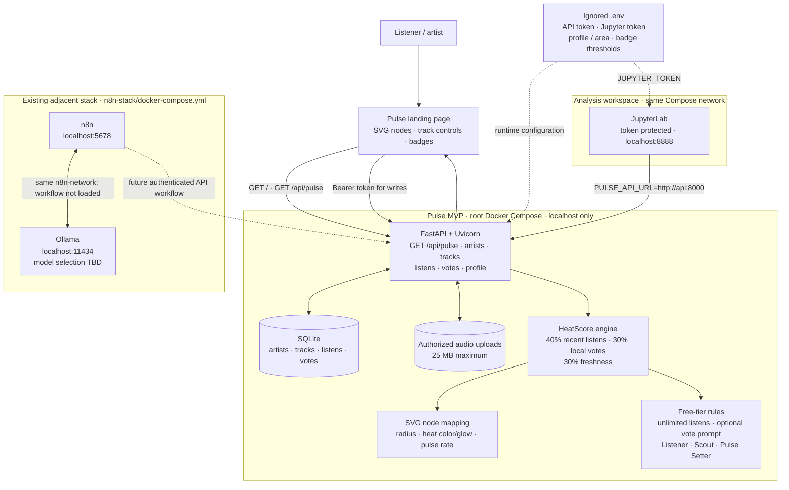

# FalCor Pulse — proof-of-concept stack

This diagram separates the runnable Pulse MVP from agentic components that exist in the repository but are not yet connected to Pulse.

## What is wired up

| Layer | MVP implementation |
|---|---|
| Experience | FastAPI-served landing page; SVG nodes refresh every 30 seconds; authorized audio upload and stream controls |
| API | FastAPI served by Uvicorn; bearer-token protected writes; public pulse summary; profile, badges, listens, votes |
| HeatScore | 0–100: `40 × min(listens_24h / 50, 1) + 30 × min(local_votes_24h / 10, 1) + 30 × max(1 - days_since_signal / 30, 0)` |
| Node rendering | Radius `12 + 0.36 × score`; cyan → violet → pink color/glow; pulse period `4.5 - 0.034 × score` seconds |
| Free tier | Unlimited listens; prompt to vote beginning with listen 51 per UTC day; voting stays optional |
| Badges | Listener (10 listens), Scout (5 local votes), Pulse Setter (first HeatScore contribution); first two thresholds are configurable |
| Persistence | SQLite and uploaded authorized audio share the persistent `pulse_data` volume |
| Analysis | JupyterLab reaches the API over the Compose network; Jupyter token is separate from the API bearer token |

With no artists in the database, the landing page shows sample HeatScore nodes at 18, 55, and 90. Those are illustrative only; populated nodes always use the live API scores.

## Runtime and agentic variables

### Configured environment

| Variable | Purpose | Default / source |
|---|---|---|
| `PULSE_API_TOKEN` | Bearer token protecting writes and profile data | Random local secret in ignored `.env`; required by Compose |
| `JUPYTER_TOKEN` | JupyterLab login token | Separate random local secret in ignored `.env` |
| `PULSE_API_URL` | API URL visible inside the Jupyter container | `http://api:8000` |
| `PULSE_DB_FILE` | SQLite database location | `/data/pulse.db` in Compose |
| `PULSE_UPLOAD_DIR` | Authorized audio storage | `/data/uploads` in Compose |
| `PULSE_PROFILE_NAME` | Label shown for the local profile | `Local Listener` |
| `PULSE_PROFILE_ID` | Local profile identifier used for listen/vote totals | `local-listener` |
| `PULSE_USER_AREA` | Area used to decide whether an artist is votable | `Local`; manually configured, not geolocation-verified |
| `PULSE_BADGE_LISTENER_STREAMS` | Listener badge threshold | `10` |
| `PULSE_BADGE_SCOUT_VOTES` | Scout badge threshold | `5` |

The vote prompt threshold (`50`), upload maximum (`25 MiB`), allowed audio formats (MP3, WAV, OGG, FLAC, M4A, AAC), recent-listen window (24 hours), vote normalization cap (`10`), and freshness window (30 days) are currently code constants, not environment settings.

### Agentic layer: now vs. next

| Agentic concern | Current state | Next wiring step |
|---|---|---|
| Goal | Help listeners discover local artists and keep the pulse current | Define an agent task contract, such as summarizing notable local changes |
| Inputs / context | Recent listens, area-matched votes, artist age/activity, track metadata | Add explicit context limits and source attribution |
| Tools | Pulse HTTP API; Jupyter for local analysis | Give an agent a restricted API client; keep voting and publishing user-confirmed |
| Memory | SQLite stores MVP records in a persistent volume | Define retention, event history, and per-user data boundaries |
| Model | Ollama container is configured in the separate n8n stack; no model is selected or loaded for Pulse | Choose a model and resource limits, then connect it through an approved workflow |
| Orchestration | n8n exists as a separate stack; no Pulse workflow or shared network is configured | Add a reviewed n8n workflow and authenticated connection to the Pulse API |
| Credentials | Pulse API and Jupyter use distinct `.env` tokens | Use separate least-privilege credentials for any future agent; never put secrets in prompts or notebooks |
| Guardrails | Licensed uploads are attested; 25 MiB cap; votes are optional and area-string matched | Add verified user accounts, authorization scopes, abuse controls, and auditable actions before public launch |

The current deployment is a single local profile and one shared API write token, not public multi-user authentication. The configured n8n/Ollama containers are separate and do not currently call the Pulse API.
